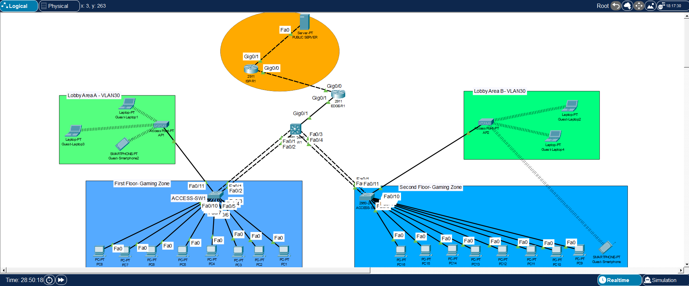

# Ryder Gaming Center Network

A gaming center network built from scratch in Cisco Packet Tracer.
Instead of one flat network, it uses an enterprise-style design with
VLAN segmentation, dynamic addressing, routing, security, and redundancy.

## Topology

## Hardware
| Device | Qty | Role |
|--------|-----|------|
| Multilayer switch | 1 | Core: inter-VLAN routing and DHCP |
| Cisco 2960 switch | 2 | Access layer for end devices |
| Edge router | 1 | Separates the private network from the ISP |
| ISP router | 1 | Routes traffic between networks |
| Wireless access point | 2 | Guest Wi-Fi coverage |
| Wired gaming PC | 16 | Spread evenly across the two access switches |

## VLAN Design
| VLAN | Name | Used for |
|------|------|----------|
| 10 | Gaming | Wired gaming PCs only |
| 20 | Staff | Front-desk systems for payments and admin work |
| 30 | Guest Wi-Fi | Customer mobile devices |
| 40 | Services | Internal infrastructure |
| 99 | Management | Remote administration of switches |

Full addressing is in [ip-vlan-table.md](ip-vlan-table.md).

## What I Configured
- **VLAN segmentation:** 5 VLANs to isolate broadcast domains and improve security
- **Access ports and PortFast:** Ports to PCs and access points go straight to
  forwarding, skipping the listening and learning states
- **LACP EtherChannel:** Redundant uplinks from each access switch to the
  multilayer switch are bundled into one logical port channel, so STP does
  not block the extra cables
- **802.1Q trunking:** The port channels are trunks, so all VLANs share the
  same physical uplinks and stay separated
- **Inter-VLAN routing with SVIs:** Routing is enabled on the multilayer
  switch, and each SVI is the default gateway for its VLAN
  (for example, 192.168.10.1 for Gaming)
- **DHCP:** The multilayer switch is the DHCP server with pools for gaming,
  staff, and guest networks. The first 20 addresses of each subnet are
  excluded for static infrastructure.
- **Remote management with SSH:** Domain name, local user database, and RSA
  keys let admins manage switches over SSH on the Management VLAN
- **NAT and PAT overload:** The edge router uses an ACL to pick the internal
  subnets and translates them to one public-facing IP
- **Guest Wi-Fi security:** An inbound ACL on the guest SVI permits DHCP,
  denies access to the private networks (192.168.0.0/16), and permits
  general internet traffic

## IP and VLAN Table
See [ip-vlan-table.md](ip-vlan-table.md)

## Test Results
| Test | Result |
|------|--------|
| Gaming, staff, and guest devices get IPs by DHCP | Pass |
| Excluded addresses are not handed out | Pass |
| EtherChannel is up (`show etherchannel summary`) | Pass |
| Trunks carry the VLANs (`show interfaces trunk`) | Pass |
| SSH access works from the Management VLAN | Pass |
| Internet reachable through NAT/PAT | Pass |
| Guest can reach the internet | Pass |
| Guest blocked from private networks (ACL) | Pass |

Screenshots are in the `screenshots` folder.
Device configs are in the `configs` folder.

## What I Learned
Initially, the network seemed broken. However, once all essential configurations were completed, 
it functioned completely as intended. 
As a new concept, I learned how to implement LACP EtherChannel for enterprise-grade networks and 
how it contributes to network redundancy and uplink capacity.

## Tools
Cisco Packet Tracer